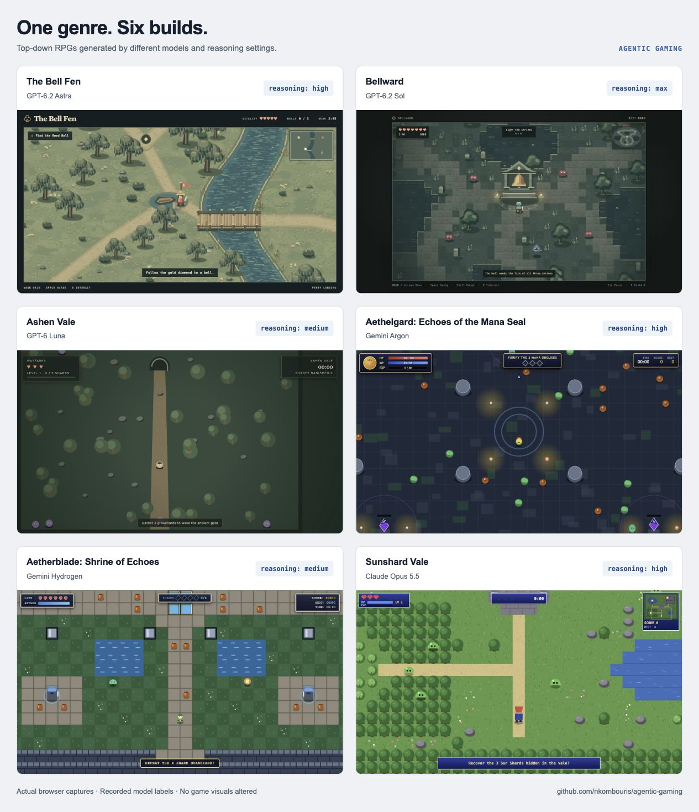

# Agentic Gaming

**Your work laptop lost Solitaire. Your coding agent can make you another one.**

Managed corporate laptops often have no Solitaire, no Minesweeper, no game installs, and no access to gaming websites. You have a browser, a coding agent, and a few minutes to spare.

So the idea is simple: **if the games are blocked, generate your own.** Small games, short rounds, and files you can open locally whenever you are bored. The comparison games need no installer, administrator access, backend, or external assets; they run wherever local HTML is permitted.

This repository collects those games and the experiment behind them: **what happens when different models, model generations, and reasoning settings tackle the same kind of game?**

Compare the different game builds at [agenticgames.qiovra.de](https://agenticgames.qiovra.de/).

## One genre, different models



*Actual browser captures of six top-down RPGs. Click the image to inspect it at full size. These are examples of the results, not a ranking.*

## What is here?

There are **42 games**: 40 builds across six comparison genres, plus two additional samples.

| Collection | Games | What to expect |
| --- | ---: | --- |
| [Top-down RPG](games/top-down-rpg/) | 9 | Explore, fight monsters, complete a compact quest |
| [Arena shooter](games/quake3arena/) | 9 | First-person movement, weapons, enemies, and an arena |
| [Turn-based tactics](games/xcom-tactics/) | 9 | Tactical turns, several enemies, and line-of-sight decisions |
| [Tower defense](games/tower-defense/) | 7 | Build and upgrade defenses against waves; includes touch-friendly builds |
| [Solitaire](games/solitaire/) | 3 | Klondike with cards, foundations, and restart |
| [Minesweeper](games/minesweeper/) | 3 | Reveal tiles, place flags, avoid mines |
| Additional samples | 2 | [Signal Match](games/signal-match/) and [Gem Circuit](games/gem-circuit/) |

The collection includes these recorded configurations:

| Model labels | Reasoning |
| --- | --- |
| GPT-6 Astra / GPT-6.2 Astra | high |
| GPT-6.1 Sol / GPT-6.2 Sol | max |
| GPT-6 Luna | medium |
| Gemini Hydrogen | medium |
| Gemini Argon | high |
| Claude Fable 5.2 | medium |
| Claude Opus 5.5 | high |

Coverage varies by genre. Model and effort names are the labels recorded for the run or supplied with an imported game. The two additional samples have no recorded model or reasoning setting.

## Play locally

1. Download this repository using **Code → Download ZIP**, or clone it.
2. Extract the files and open `games/<genre>/<model>/index.html` in a desktop browser.
3. Read the controls on the start screen, then play.

For example, open [`games/solitaire/luna/index.html`](games/solitaire/luna/index.html) for **Moonlit Tableau**, or [`games/top-down-rpg/astra-6.2/index.html`](games/top-down-rpg/astra-6.2/index.html) for **The Bell Fen**.

The 40 comparison builds are self-contained HTML files with inline CSS and JavaScript. Keep the entire folder for Signal Match and Gem Circuit: those samples also use the supplied `game.js` and `styles.css` files. Their editable source is included as well.

Most builds target keyboard and mouse. Check each game's `metadata.json` for `mobileSupported` and the notes explaining its touch controls or limitations. A responsive canvas alone does not mean the game supports mobile play.

## Play through GitHub Pages

GitHub's repository file viewer displays HTML source. **GitHub Pages** serves it as an actual web page, so the same files become playable links without changing the games.

To publish this collection, open [repository Settings → Pages](https://github.com/nkombouris/agentic-gaming/settings/pages), choose **Deploy from a branch**, select **main** and **/(root)**, then save. After the first deployment, an individual game will be available at a URL such as:

```text
https://nkombouris.github.io/agentic-gaming/games/solitaire/luna/
```

The existing `games/` directory structure stays intact. See [GitHub's publishing-source instructions](https://docs.github.com/en/pages/getting-started-with-github-pages/configuring-a-publishing-source-for-your-github-pages-site) for the setup.

## How the experiment works

- Give agents a shared game-generation brief and a genre. The brief asks for a complete core loop, visible controls, a HUD, win/lose conditions, and restart.
- Run builds in isolated directories so agents cannot overwrite each other's work.
- Compare gameplay, controls, visual choices, completeness, and the amount of fixing needed across models and reasoning settings.
- Keep earlier generations alongside newer runs. For example, `astra/` and `astra-6.2/` are separate entries.
- Save the exact prompt and its hash where available. The GPT-6.2 reruns preserve the earlier genre prompts; [this saved RPG prompt](games/top-down-rpg/astra-6.2/game-prompt.txt) is one example.
- Record what was actually checked. Syntax checks, browser smoke tests, and full gameplay testing are different kinds of evidence.

This is an evolving collection, not a controlled benchmark. Some games were imported from other agents, some received documented fixes, and prompts are not preserved for every entry. Recorded wall-clock times also use different timing boundaries, described in each file; they should not be treated as model-speed rankings.

## Generate your own game

Choose a model and reasoning level in your coding agent, replace `{GENRE}` with a genre such as `Solitaire`, `Minesweeper`, `top-down RPG`, or `first-person arena shooter`, and paste the complete prompt below. For comparisons, use the same filled-in prompt across runs and record the model and reasoning setting separately.

```text
Build a small, immediately playable single-player browser game.
Genre: {GENRE}

If {GENRE} is empty or unfilled, pick a well-known genre and say which. If it
names a specific existing game, build an original take on its genre: new name,
visuals, and level layout, not a recreation.

SCOPE & PACE: size scales with your ability; process does not.
- Plan briefly: pick the concept and mechanics, then write. No design docs.
- Write index.html in one pass, as complete as you can make it. Typical size is
  400–1200 lines (2D) or 700–1500 lines (WebGL); stay under ~1800.
- Must have: core loop, controls, HUD, win/lose, restart.
- Should have (in the same pass, if natural): juice (particles, screen shake,
  hit feedback), a difficulty ramp, enemy or obstacle variety, a high score in
  localStorage.
- Skip: menus beyond start/game-over, settings, levels beyond one, touch input.
- Target desktop keyboard/mouse. A round should last 1–3 minutes, with
  difficulty that rises over time.
- After the first write: at most 2 fix rounds, only for errors found by the
  check. No refactors, no rewrites, no new features after the check.
- Hand over as soon as the check passes.

CLARIFY: use the genre's familiar camera, controls, and core loop. Ask one short
multiple-choice question and wait only if the genre is truly ambiguous in a way
that changes the build (e.g. shooter: first-person or third-person). Otherwise
pick sensible defaults, state the game concept in one sentence, and build
immediately.

FILES: create a unique directory for this game. Use the session's
scratchpad/temporary directory if one is provided; otherwise `mktemp -d`. Keep the
game, any check files, and any screenshots there. Never write to the current
project or repository, home folders (Desktop, Documents, Downloads), or global
config. Do not delete the game directory afterwards.

TECH: exactly one self-contained index.html with inline CSS and classic,
non-module JavaScript (no type="module"). It must work when opened directly via
file://. No imports, fetch, external assets, CDNs, libraries, dependencies,
backend, HTTP server, build step, or deployment. Draw simple original visuals in
code. Sound is optional, only via WebAudio, and only after a user gesture.

RENDERING:
- 2D genres: Canvas 2D.
- Grid-based first-person (maze, dungeon, corridor shooter): a Canvas 2D
  raycaster is simpler and more robust; prefer it.
- Free 3D movement (third-person, flight, racing, open-arena first-person):
  native WebGL (WebGL1, or WebGL2 if useful), with no libraries. Keep it simple:
  - geometry built in code: boxes, planes, low-poly shapes; no textures
  - one shader program with vertex colors and flat/Lambert lighting, plus
    optional fog for depth
  - small hand-written mat4 helpers (perspective, lookAt, translate, rotate,
    multiply); keep them correct and minimal
  - enable depth testing; set the viewport on resize
  - check shader compile and program link status and console.error the logs
  - if WebGL is unavailable, show a readable on-screen message, not a blank page
  - draw HUD and overlays as an HTML layer or a 2D canvas over the WebGL canvas

GAME REQUIREMENTS: the smallest recognizable version of the genre, done well:
- one compact arena or level
- essential mechanics and basic AI where needed
- HUD showing score/health/time or whatever the genre needs
- controls listed on the start screen
- win and/or lose condition, with restart (R key and a click/button)

LOOP & INPUT:
- click-to-start overlay (also satisfies pointer-lock/audio gesture rules)
- first-person mouse look: Pointer Lock on click, with a sensitivity that
  feels right by default
- requestAnimationFrame with delta time, clamped to 0.05s
- preventDefault on game keys (arrows, Space) so the page doesn't scroll
- on blur/visibilitychange: pause, clear held inputs, release pointer lock
- fit the canvas to the window; handle resize and devicePixelRatio

CHECK: extract the inline <script> contents and run `node --check` on them (or
parse them with `new Function()` if Node is unavailable). If a browser tool is
already available, do one brief smoke test: load the page, start the game,
confirm no console errors, and confirm the start overlay appears. For WebGL,
also confirm the scene is not blank: a screenshot, or gl.readPixels on a few
points after a frame differs from the clear color. No test suites, no extended
QA. Fix only what the check finds, within the 2 fix rounds.

HANDOFF:
- a clickable absolute path to index.html
- one-sentence concept and concise controls
- if the agent's built-in browser can open file:// URLs, open it there;
  otherwise tell the user to open the file in a desktop browser
- state exactly what was verified (syntax check, smoke test, render check,
  or none)
- note that the file is in a temporary location and may be removed by
  session/system cleanup
```

This is the desktop template. For touch-only play, use the [mobile tower-defense variant](games/tower-defense/astra-6.2/game-prompt.txt), which replaces the desktop-only input requirements and adds a check of the touch controls.

## Files and metadata

```text
games/
├── top-down-rpg/
│   ├── catalog.json
│   ├── astra/
│   │   ├── index.html
│   │   └── metadata.json
│   ├── astra-6.2/
│   │   ├── index.html
│   │   ├── metadata.json
│   │   └── game-prompt.txt
│   └── ...
├── quake3arena/
├── xcom-tactics/
├── tower-defense/
├── solitaire/
├── minesweeper/
├── signal-match/
├── gem-circuit/
└── shared/
```

Each game's metadata records its title, agent, model, reasoning setting, generation timing, mobile support, and validation where known. Some entries also include source hashes, prompt hashes, or revision history. Unknown values remain `null` or are omitted rather than guessed.

The goal is a small, inspectable game you can actually play—and a useful record of how different agents got there.
